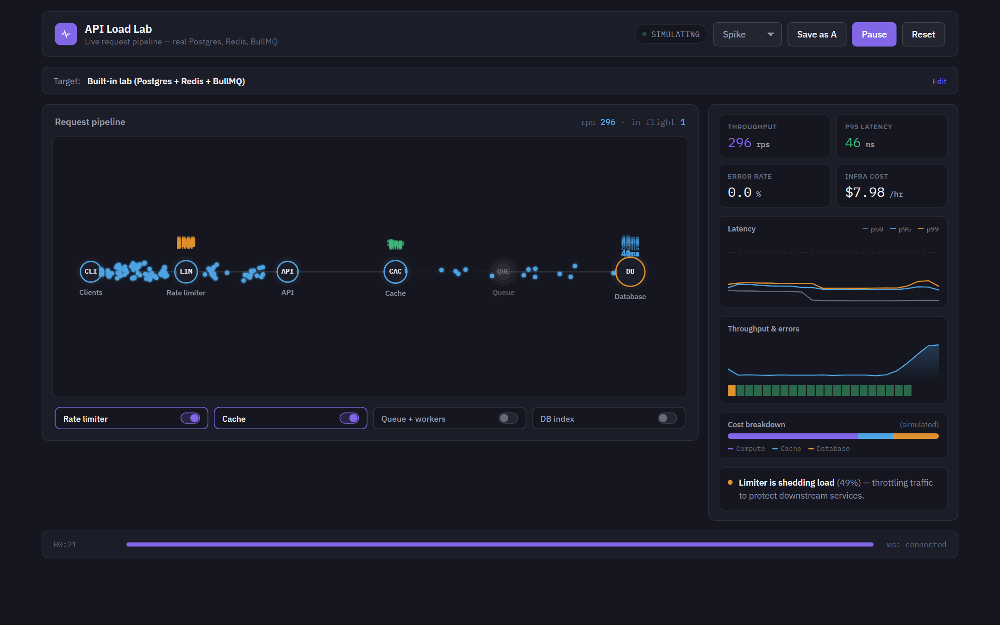
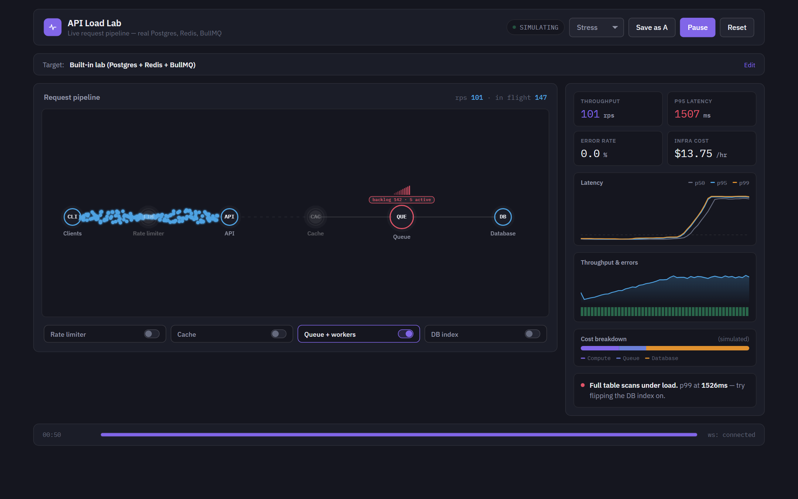
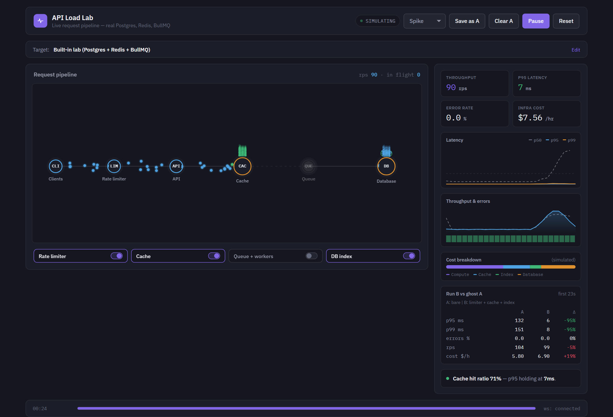
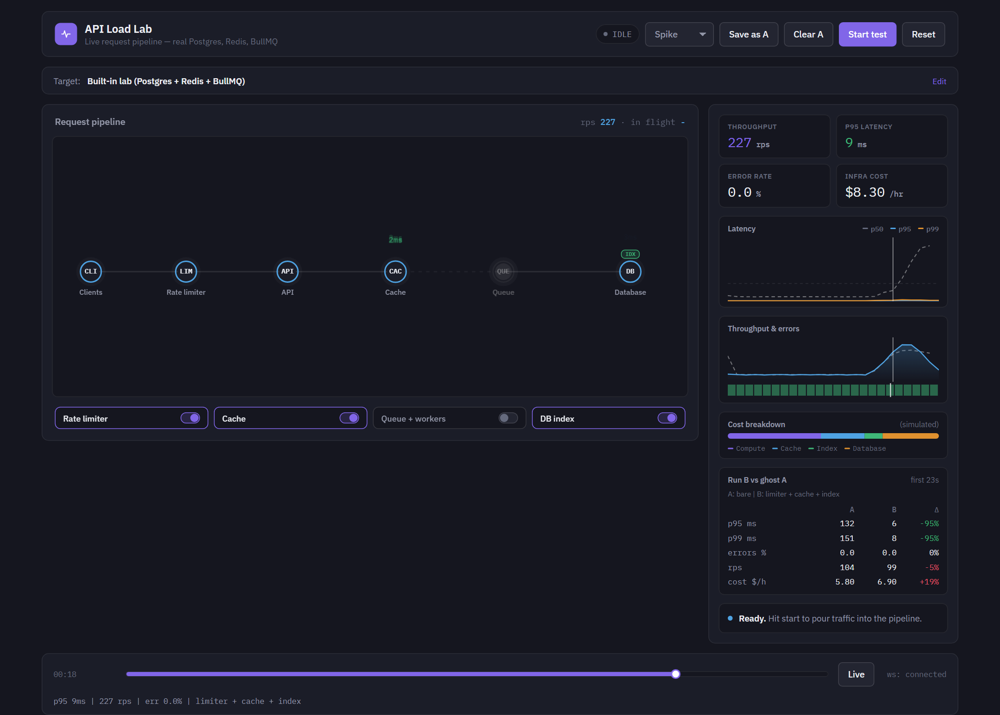
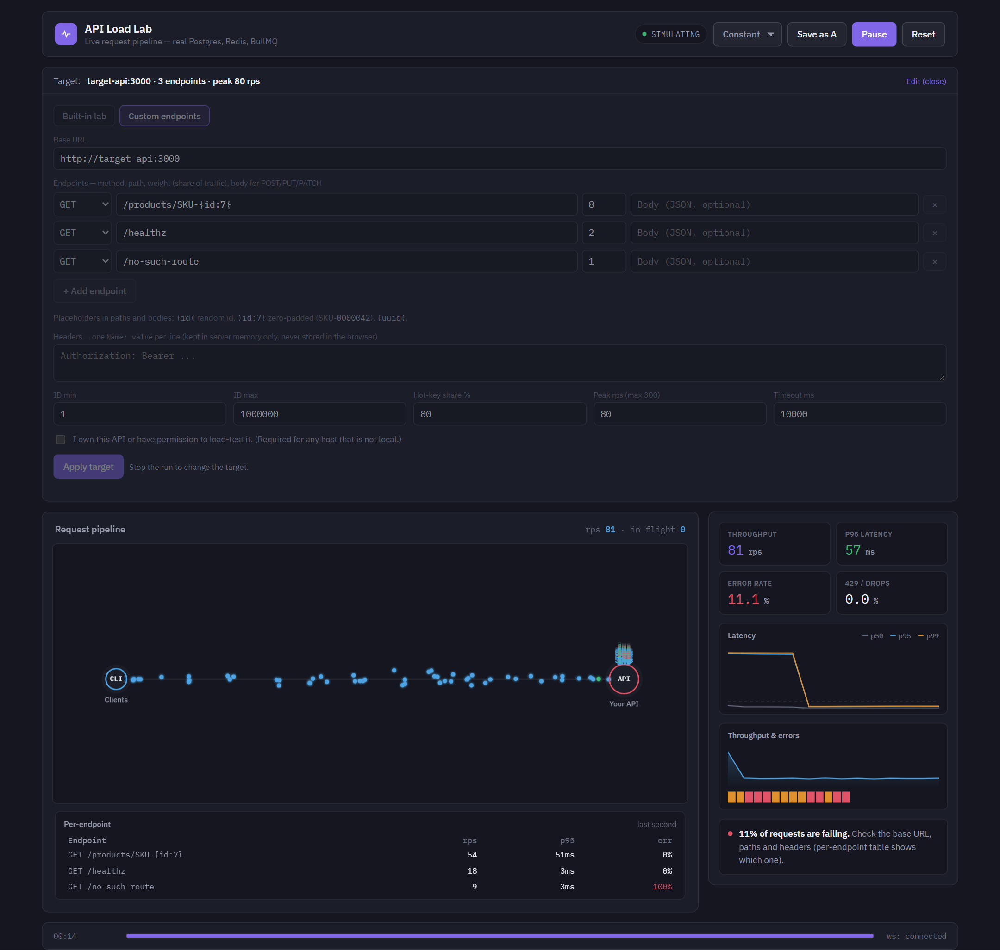
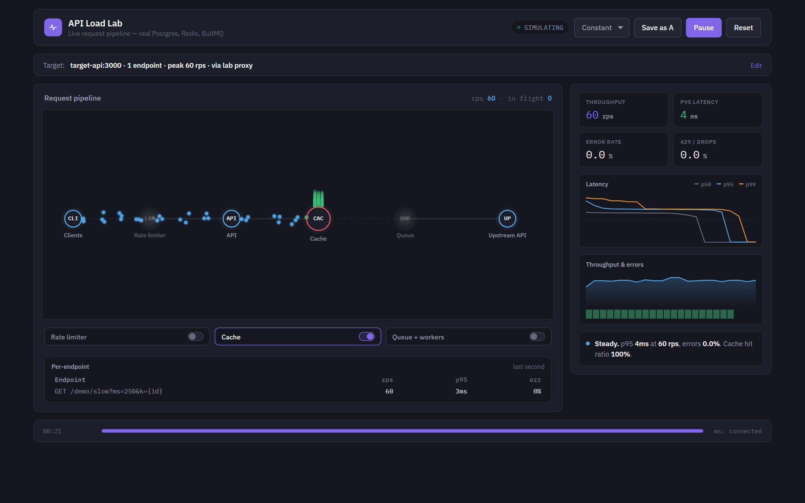

# API Load Lab

**Don't guess what a cache, an index or a queue would do to your API. Switch it on while traffic is flowing and watch the p95 move.**

A live load-testing playground. Pour traffic into an API, watch every request travel through the
pipeline, flip real infrastructure toggles (cache, DB index, queue, rate limiter) and see the p95
move - or point it at **your own endpoints** and get per-endpoint latency and error numbers.

**Stack:** TypeScript, Fastify, PostgreSQL (1M-row table), Redis, BullMQ, WebSocket metrics stream,
a single-page vanilla-JS dashboard (no framework, no build step), Docker Compose (one command to run).

**Why it is interesting:** nothing on the dashboard is faked - latencies are measured around real
HTTP round trips against real Postgres, Redis and BullMQ. The README is also upfront about its
limits (coordinated omission, shared-machine numbers) in the *Known limitations* section.



Everything on the dashboard is measured from real HTTP round trips against real Postgres, Redis and
BullMQ. Only the "infra cost" figure is a model (there is no cloud bill to read locally).

## What you can do

| | |
|---|---|
| **Built-in lab** | 1M-row Postgres table behind a Fastify API. Toggle a Redis cache, a DB index (a real `CREATE INDEX`), a BullMQ queue with workers, and a token-bucket rate limiter - while traffic is flowing. |
| **Custom endpoints** | Test any HTTP API from the UI: base URL, several endpoints with weights, headers, `{id}` / `{uuid}` placeholders, peak rps. Per-endpoint rps / p95 / error table. |
| **Lab proxy** | Put the lab's real Redis cache, rate limiter and bounded queue **in front of any GET API** and ask "what if this endpoint had a 30 s cache?" with real measurements. Toggle the pieces live. |
| **Race mode (A vs B)** | Save a run as the dashed *ghost A*, change the config, run again, and compare p95, p99, errors, rps and cost side by side. State is reset between runs so the comparison is fair. |
| **Timeline scrubber** | Drag the footer timeline (or use the arrow keys) to inspect any second of a run - live or after it stops. Charts, tiles and the readout follow the cursor. |
| **Queue backlog** | The Queue node shows the real BullMQ backlog and active jobs, and turns red as it grows. |

## Quick start

Requires Docker (Compose v2). Node is only needed for the screenshot script.

```bash
docker compose up --build
```

Open **http://localhost:4000**. First boot seeds `products` with 1,000,000 rows (pure SQL, a few
seconds).

| Service | URL | Role |
|---|---|---|
| `control-api` | http://localhost:4000 | Dashboard, load generator, WebSocket metrics stream |
| `target-api` | http://localhost:3000 | The system under test (Postgres + Redis + BullMQ) |
| `worker` | - | Processes queued lookups |

The Dockerfiles use a BuildKit npm cache mount, so dependency installs are cached between rebuilds.

## Using it

### 1. Built-in lab

1. Pick a profile (`constant`, `ramp`, `spike`, `stress`, `soak`) and press **Start test**.
2. Flip the toggles while it runs. Try **DB index** during a spike, or **Queue + workers** under
   `stress` with the cache off and watch the backlog build.



### 2. Race mode and the scrubber

1. Run with one configuration, press **Save as A**.
2. Change toggles (or the target), start again. The ghost A is drawn dashed under the live run and
   the **Run B vs ghost A** table updates every second.
3. After stopping, drag the timeline to look at any second. A is stored in your browser
   (`localStorage`); the recorded live run lives in the page and is cleared by the next run.





### 3. Your own endpoints

Open **Target -> Custom endpoints**, fill in the form, **Apply target**, start a run.

- **Base URL** - `https://api.example.com`. If the API runs on your machine and `control-api` is in
  Docker, use `http://host.docker.internal:PORT`.
- **Endpoints** - method (`GET HEAD POST PUT PATCH`), path, weight (share of traffic), optional body.
  Placeholders in paths and bodies: `{id}` random id, `{id:7}` zero-padded (`SKU-0000042`), `{uuid}`.
- **Headers** - one `Name: value` per line, for example `Authorization: Bearer ...`. Values are kept
  in `control-api` memory only; they are never written to disk or the browser, and never sent back
  to the UI (only the names are).
- **ID range / hot-key share** - ids are drawn from your range; a configurable share of requests
  reuses a small hot set, which is what makes caches matter.
- **Peak rps** - the profile shape is scaled to this value (hard cap 300).



Reading the results: HTTP 429 counts as *rate-limited* (drops), any other 4xx/5xx or network error
or timeout counts as an *error*. The per-endpoint table shows which endpoint is failing or slow.

### 4. What if this API had a cache in front of it? (lab proxy)

A black-box API can't be changed from the outside - you can only measure it. The lab proxy answers
the "what if" question for real instead of simulating it: tick **Route through the lab proxy** in the
custom form and requests go `control-api -> target-api /proxy -> your API`. In between sit the same
switchable pieces as the built-in lab:

- **Rate limiter** - token bucket in front of the upstream.
- **Cache** - Redis read-through keyed by path + query, TTL configurable (default 15 s).
- **Queue + workers** - BullMQ with a bounded number of workers (*upstream concurrency*, default 5).
  Throughput is capped at `workers / upstream latency`; the rest becomes a visible backlog.

Flip the toggles while traffic flows, or save a run as ghost A and compare. The headline
numbers still come from real round trips.



`target-api` ships a deliberately slow stub (`/demo/slow?ms=250&k=7`) so you can try this without a
third-party API: base URL `http://target-api:3000`, path `/demo/slow?ms=250&k={id}`, ids 1-50.
Measured on that stub at 60 rps (constant profile):

| Config | p95 | Notes |
|---|---|---|
| no cache, no queue | ~290 ms | every request waits for the upstream |
| cache on | ~4 ms | ~100% hit ratio |
| queue only (5 workers) | ~5 s | capped at ~20 rps, backlog grows |
| cache + queue | ~3 ms | |

Limits of this mode: **GET only** (responses are cached and replayed), upstream headers are fixed
per target and not forwarded from clients, cached answers can be up to *TTL* seconds stale, and
bodies over 1 MB are not forwarded. Your upstream receives real requests from the lab, so the same
ownership/permission rules as the rest of custom mode apply.

**Guardrails.** This tool can generate real traffic, so it is deliberately conservative:
only `http(s)` URLs, peak rps capped at 300 and 100 concurrent requests, at most 10 endpoints,
link-local addresses (cloud metadata) are rejected, and any host that is not local/private requires
ticking *"I own this API or have permission to load-test it"*. Only test systems you own or are
explicitly allowed to test.

## Architecture

```
 browser (dashboard, canvas, charts)
     |  HTTP + WebSocket
 control-api :4000 ----- load generator + metrics (p50/p95/p99, rps, errors)
     |  GET /products/...          |  your endpoints (custom mode, direct or via /proxy)
 target-api :3000  -- toggles -->  Redis cache | BullMQ queue -> worker | token-bucket limiter
     |
 Postgres (1M rows, optional index)
```

- `services/control-api` - Fastify. Serves the UI, runs load profiles, forwards toggles, streams ticks.
- `services/target-api` - the lab backend with real, switchable components.
- `db/init.sql` - schema and seed.

### control-api HTTP API

| Method | Path | Body | Notes |
|---|---|---|---|
| `POST` | `/run/start` | `{ "profile": "spike" }` | Resets cache/queue first (lab mode). |
| `POST` | `/run/stop` | | |
| `POST` | `/toggles` | `{ "cache": true, "queue": false, "index": true, "limiter": true }` | Lab mode and lab-proxy mode; forwarded to `target-api`. (`index` only affects the built-in lab.) |
| `GET/POST` | `/target` | `{ "mode": "lab" }` or `{ "mode": "custom", "baseUrl", "endpoints": [...], "viaProxy": true, "proxyTtlSec": 15, "proxyConcurrency": 5, ... }` | `409` while a run is active, `400` with a message when invalid. |
| `GET` | `/state` | | Current run, toggles and target. |

### WebSocket `ws://localhost:4000/ws`

A `snapshot` on connect, then a `tick` every second, plus `event` (per-request outcome for the
particle animation), `state`, `toggles` and `target` messages.

`tick`: `t, mode, rps, err, p50, p95, p99, hitRatio, dropRate, inFlight, queueDepth, queueActive,
cost, breakdown, endpoints[{label, rps, err, drop, p95}], toggles`.

## What is real vs. simulated

- **Real:** every latency number (measured around `fetch`, including the response body), cache
  hits, queue depth and active jobs, rate limiting, index creation, per-endpoint stats.
- **Simulated:** `cost` / the cost breakdown (a stand-in model for "what would these components cost
  at this throughput"). It is hidden in custom mode.

## Known limitations

- Percentiles are computed over the last 400 samples, not an exact per-second window.
- Headline p95 lags a few seconds behind a change (it covers the last 400 requests); the per-endpoint table is last-second and reacts immediately.
- The generator caps in-flight requests (150 lab / 100 custom). Under heavy overload it sends less
  than the target rate instead of queueing (a form of coordinated omission), so treat very high
  latencies as "the system is saturated", not as an exact figure.
- Generator and system under test share one machine, so absolute numbers depend on your hardware;
  they are meaningful relative to each other.
- A live *parallel* A/B race (two stacks side by side) is not implemented - see
  [`docs/deferred-parallel-race.md`](docs/deferred-parallel-race.md) for the plan.

## Development

```bash
npm install                      # workspaces: services/target-api, services/control-api
npm run build                    # tsc for both services
docker compose up -d --build control-api   # rebuild one service
```

Regenerate the README screenshots from the running stack (needs Chrome or Edge, Node 22+). It runs
real scenarios through the UI, takes about three minutes and leaves the stack in its default state:

```bash
node scripts/capture-screenshots.mjs
```
